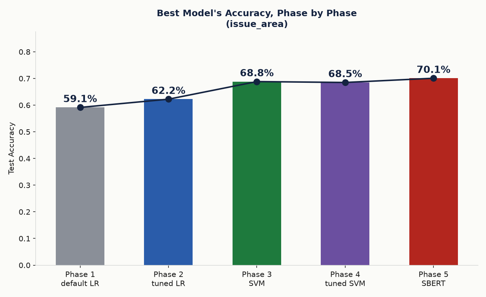
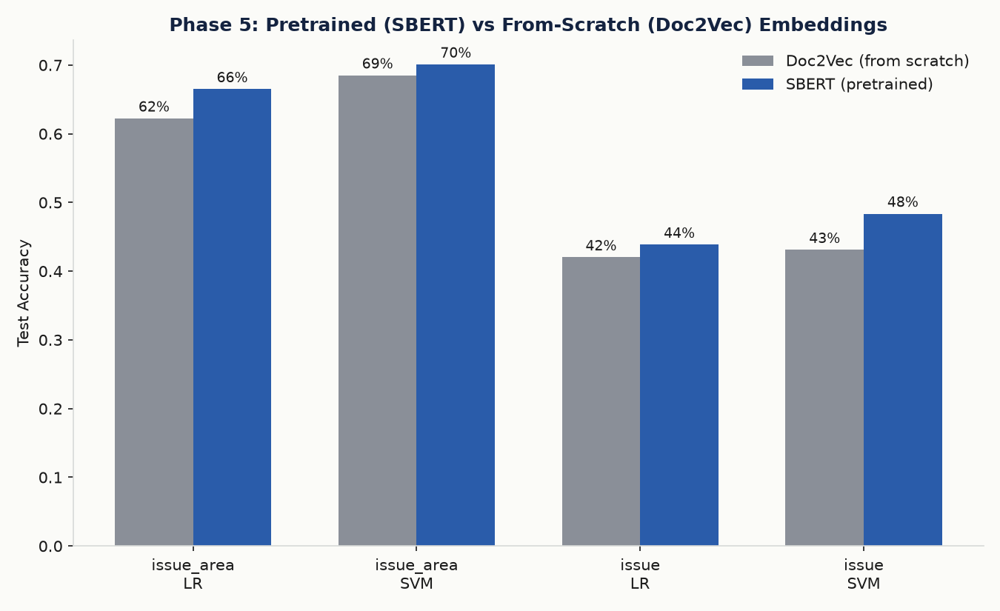
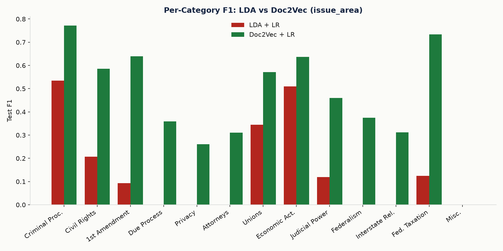
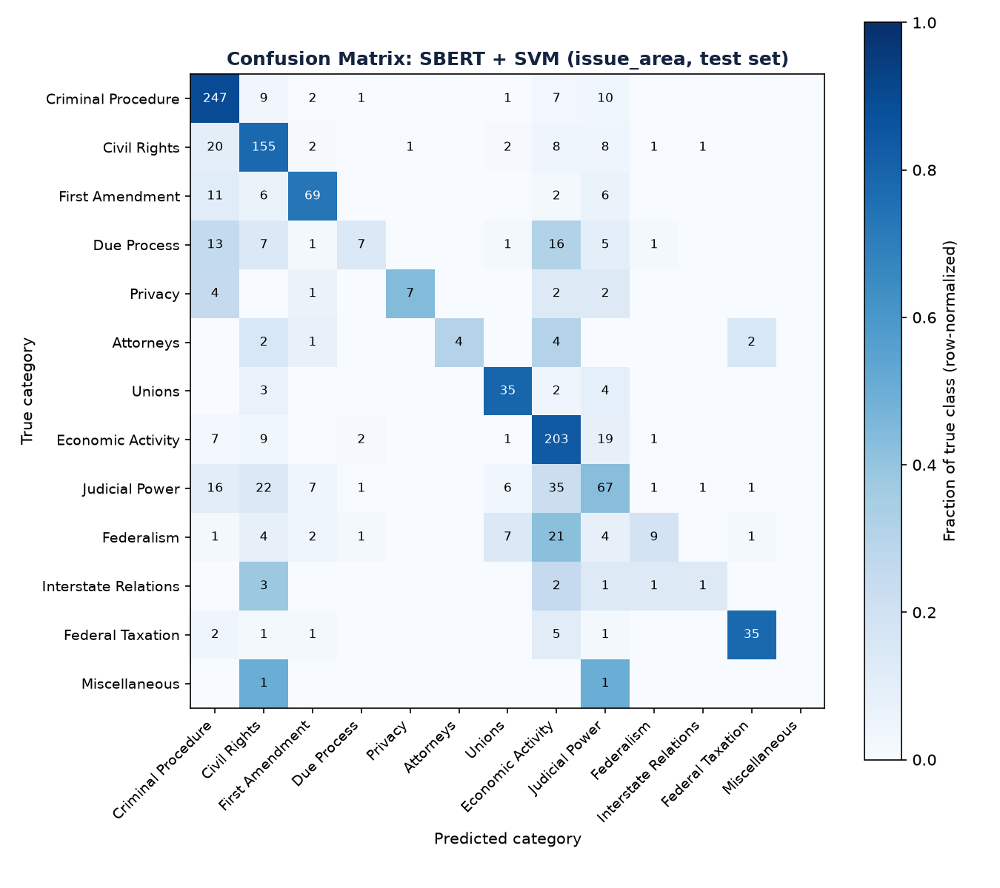

# ML-MINI-PROJECT

Classification of US Supreme Court legal opinions — replicating and extending
the Stanford CS229 project *"Classification of Legal Text"* (Krithika Iyer,
2020) across five phases, from the paper's original methods through a modern
pretrained embedding model.

## Problem statement

Classify US Supreme Court opinions into their legal subject-matter category,
at two granularities:
- **issue_area** — 15 broad human-curated categories (e.g. Criminal
  Procedure, Civil Rights, First Amendment).
- **issue** — ~260-280 fine-grained issue codes.

Legal opinions use long, non-standard sentence structures that break typical
NLP tooling. The paper explores whether topic-model and embedding features,
fed into a simple classifier, can recover the human-expert categories; we
replicate that, then test whether classifier choice and modern pretrained
embeddings can do meaningfully better.

## Dataset

**Real dataset, no substitute needed.** The paper uses the Supreme Court
Database (Washington University, http://scdb.wustl.edu) via the `textacy`
package's bundled `SupremeCourt` dataset — the exact same source is still
downloadable today (`textacy.datasets.SupremeCourt`, ~111MB, 8,419 opinions,
1946-2016).

After dropping opinions with no `issue_area` label and issue codes with
fewer than 10 examples (needed so every class can appear in train/dev/test),
**7,971 opinions** remain, split 70/15/15 (train/dev/test), stratified by
`issue_area`.

Deviation from the paper: opinions run very long (median ~34k characters);
we truncate each to its first 4,000 characters before vectorizing, to keep
LDA/Doc2Vec training tractable. Most opinions state the issue and holding
early, so this keeps the dominant vocabulary.

## Approach — three feature extractors, four classifiers, five phases

| Method | What it is | Training |
|---|---|---|
| **LDA** (the paper's Experiment 1) | gensim topic model over TF-IDF; document = topic-probability vector | From scratch, per run |
| **Doc2Vec** (the paper's Experiment 2) | gensim paragraph-embedding model | From scratch, on our ~5,600 training docs only |
| **SBERT** (our Phase 5 addition) | `all-MiniLM-L6-v2`, pretrained on 1B+ sentence pairs | **None** — only used to encode |

Classifiers on top: Logistic Regression (the paper's), plus **SVM**,
**Random Forest**, and **Gaussian Naive Bayes** (none of which the paper
tries). **Experiment 3 (BERT fine-tuning) is not replicated** — the paper's
own attempt ran out of memory on Google Colab and produced no results to
reproduce; this is a documented limitation, not an oversight.

**Preprocessing** ([`src/data/preprocessing.py`](src/data/preprocessing.py)):
load via textacy, drop unlabeled/rare classes, truncate to 4,000 chars.
Two tokenizations are kept: a stopword-stripped bag-of-words (for LDA/Doc2Vec)
and the raw cleaned text (for SBERT, which needs real sentences — punctuation,
casing and word order all carry meaning for a pretrained transformer).

| Phase | Script | What it does |
|---|---|---|
| 1 — Replicate | [`scripts/01_replicate.py`](scripts/01_replicate.py) | LDA+LR and Doc2Vec+LR with the paper's rough default settings, both label tasks |
| 2 — Tune features | [`scripts/02_tune_features.py`](scripts/02_tune_features.py) | Tunes LDA `num_topics` / Doc2Vec `vector_size` and each classifier's `C`, selected on dev |
| 3 — Compare classifiers | [`scripts/03_compare_classifiers.py`](scripts/03_compare_classifiers.py) | SVM / Random Forest / Naive Bayes vs. LR, same tuned features |
| 4 — Deep-tune the winner | [`scripts/04_tune_classifiers.py`](scripts/04_tune_classifiers.py) | 40-config grid search on just the single best model (SVM+Doc2Vec+issue_area), selected on dev **accuracy** |
| 5 — Pretrained embeddings | [`scripts/05_sbert.py`](scripts/05_sbert.py) | Swaps Doc2Vec for SBERT, same classifiers/tasks, zero training |

All hyperparameter and classifier selection uses only the dev split; test is
evaluated exactly once per final configuration.

## A note on the paper's own Table 1

The paper's text says: *"The classification accuracy for the 279 issue_code
is around 0.133. When only the issue_areas (15 categories) are considered,
the classification accuracy jumps to 0.47."* — i.e. **15-label ≈ 0.47,
279-label ≈ 0.13** for LDA+LR. But the paper's **printed Table 1 has the
columns swapped** (`15-Labels = 0.13`, `279 Labels = 0.47`), which
contradicts its own text (fewer, broader classes should be *easier*, not
harder, to predict). We report our results using the paper's own text-stated
mapping as ground truth, and note this inconsistency for transparency.

## Results

### Progress across all five phases (Doc2Vec/SBERT + issue_area)

| Phase | Model | Test Acc | Test Macro-F1 |
|---|---|---|---|
| 1 — Replicate | Doc2Vec + LR (paper defaults) | 59.1% | 0.463 |
| 2 — Tune features | Doc2Vec + LR (tuned) | 62.2% | 0.477 |
| 3 — Compare classifiers | Doc2Vec + SVM (default) | 68.8% | 0.499 |
| 4 — Deep-tune winner | Doc2Vec + SVM (polynomial kernel) | 68.5% | **0.547** |
| 5 — Pretrained embeddings | **SBERT + SVM** | **70.1%** | 0.526 |



**Phase 4** selected on dev *accuracy* specifically (earlier phases used
macro-F1) because the deployed model's accuracy is what matters in practice.
Even so, test accuracy held flat (68.8%→68.5%, within noise for an
~850-example test set) while macro-F1 rose meaningfully via a kernel change
(RBF→polynomial, degree 3).

**Phase 5's SBERT beats every Doc2Vec variant at every feature/task/classifier
combination tried** — a pretrained model, with zero training, outperforms a
model trained from scratch on our small corpus. This is the project's
headline finding: pretraining matters more than hyperparameter tuning.



### Table 1 — Phase 1 replication (paper's default settings)

| Model | Label task | Dev Acc | Dev Macro-F1 | Test Acc | Test Macro-F1 |
|---|---|---|---|---|---|
| lda_lr | issue_area (15-label) | 0.3824 | 0.1557 | 0.3935 | 0.1487 |
| lda_lr | issue (fine-grained) | 0.0803 | 0.0116 | 0.0827 | 0.0129 |
| doc2vec_lr | issue_area (15-label) | 0.5757 | 0.4742 | 0.5915 | 0.4629 |
| doc2vec_lr | issue (fine-grained) | 0.3674 | 0.2992 | 0.3709 | 0.2901 |

**Comparison with the paper** (using its text-stated mapping): our LDA+LR
15-label test accuracy (0.39) sits reasonably close to the paper's 0.47;
our fine-grained 0.08 matches its 0.13 in the same low range. Doc2Vec+LR
15-label (0.59) is close to the paper's 0.63; fine-grained (0.37) is below
its 0.48, likely due to our stricter class filtering and 4,000-character
truncation.

Full JSON: [`results/table1.json`](results/table1.json).

### Table 2 — Per-category test performance on issue_area



Numbered categories follow the SCDB `issue_area` codes (1=Criminal
Procedure, 2=Civil Rights, 3=First Amendment, 4=Due Process, 5=Privacy,
6=Attorneys, 7=Unions, 8=Economic Activity, 9=Judicial Power, 10=Federalism,
11=Interstate Relations, 12=Federal Taxation, 13=Miscellaneous). Both
Doc2Vec and SBERT generalize far better to minority categories (5, 6, 11)
than LDA, which collapses to the majority classes (1, 8) — same pattern the
paper itself reports on its own Table 2.

### Confusion matrix — the deployed model (SBERT + SVM)



Economic Activity (the largest category) pulls in misclassifications from
Judicial Power (35 opinions) and Federalism (21) — a concrete picture of
the majority-class-bias pattern above.

### Error analysis

A confident mistake: an **Attorneys** fee-dispute opinion, whose text is
dominated by bond/surety financial language, was classified as **Federal
Taxation** at 97% confidence — the model reads surface vocabulary, not legal
reasoning. A clear correct call: an opinion with explicit labor-law
vocabulary ("Secretary of Labor," "union election," "Labor-Management
Reporting and Disclosure Act") was correctly classified as **Unions**. The
pattern holds throughout: the model does well when a case's language
matches its category, and struggles when the real legal issue is buried
under financial or procedural detail.

### Classifier comparison (Phase 3, full data)

| Classifier | Feature | Label task | Test Acc | Test Macro-F1 |
|---|---|---|---|---|
| logistic_regression | doc2vec | issue_area | 0.6224 | 0.4769 |
| **svm** | **doc2vec** | **issue_area** | **0.6884** | **0.4993** |
| random_forest | doc2vec | issue_area | 0.5957 | 0.3171 |
| naive_bayes | doc2vec | issue_area | 0.5873 | 0.4620 |
| logistic_regression | lda | issue_area | 0.4871 | 0.2674 |
| svm | lda | issue_area | 0.4912 | 0.2655 |
| random_forest | lda | issue_area | 0.4612 | 0.2526 |
| naive_bayes | lda | issue_area | 0.1312 | 0.1369 |
| svm | doc2vec | issue | 0.4311 | 0.2647 |
| logistic_regression | doc2vec | issue | 0.4202 | 0.2888 |
| naive_bayes | doc2vec | issue | 0.3709 | 0.2522 |
| random_forest | doc2vec | issue | 0.3400 | 0.1730 |
| random_forest | lda | issue | 0.2114 | 0.1292 |
| svm | lda | issue | 0.1855 | 0.0803 |
| naive_bayes | lda | issue | 0.0744 | 0.0746 |

SVM, Random Forest and Gaussian Naive Bayes ran with default hyperparameters
(not tuned on dev) in this phase, unlike Logistic Regression's `C`. All
results are single-seed, single-split (test set ~1,200 opinions), so gaps
under ~1 percentage point are not reliable. Random Forest and Naive Bayes
both underperform Logistic Regression on Doc2Vec; Naive Bayes collapses
especially badly on LDA (13% accuracy) since its per-feature Gaussian
assumption doesn't fit topic-probability vectors.

Full JSONs: [`results/classifier_comparison.json`](results/classifier_comparison.json),
[`results/tuned_classifiers.json`](results/tuned_classifiers.json),
[`results/sbert_results.json`](results/sbert_results.json).

## Setup & running

```bash
pip install -r requirements.txt
python scripts/01_replicate.py           # Phase 1: downloads corpus (~111MB, cached after), replicates both methods
python scripts/02_tune_features.py       # Phase 2: dev-only hyperparameter tuning (slow: several LDA/Doc2Vec refits)
python scripts/03_compare_classifiers.py # Phase 3: SVM / Random Forest / Naive Bayes on the tuned features
python scripts/04_tune_classifiers.py    # Phase 4: deep grid search on just the Phase 3 winner, dev-accuracy selected
python scripts/05_sbert.py               # Phase 5: SBERT vs Doc2Vec, same classifiers/tasks
python src/reports/make_report_assets.py # builds comparison_table.md + all charts from the results
python src/reports/make_writeup_pdf.py   # builds report/writeup.pdf
python src/reports/make_slides_pptx.py   # builds report/slides.pptx
```

### Live demo: classify one document

```bash
python scripts/train_best_model.py                    # once: trains + saves SBERT+SVM, the overall best model (~5 min)
python scripts/extract_samples.py --n 10               # pulls 10 real test-set opinions into samples/
python scripts/predict.py --file samples/05_criminal_procedure.txt
python scripts/predict.py "paste any legal text here"  # or classify your own text directly
python scripts/predict.py                               # no argument: interactive prompt
python scripts/evaluate_best_model.py                   # confusion matrix -> results/figures/confusion_matrix.png
```

`predict.py` prints the top-3 predicted `issue_area` categories with
confidence scores, using the saved SBERT+SVM model (70.1% test accuracy —
our best across all five phases). `extract_samples.py` writes real opinions
from the held-out test split (with their ground-truth label in a
`#`-comment header that `predict.py` strips before classifying, so it can't
leak into the prediction).

## Conclusions

- **Pretrained embeddings (SBERT) beat from-scratch ones (Doc2Vec) at every
  single comparison point** — the project's headline finding. A model that's
  never seen a court opinion before, with zero training, outperforms one
  trained from scratch on our corpus.
- **Classifier choice matters almost as much as features**: SVM beat every
  other classifier tried, on both Doc2Vec and SBERT features.
- Tuning gave real gains in Phases 1-3; Phase 4's deeper search on the
  single best model traded flat accuracy for a meaningful macro-F1 gain —
  a reminder that dev-set selection metric shapes what "improvement" means.
- LDA's macro-F1 is far below its accuracy — it defaults to majority classes
  (Criminal Procedure, Economic Activity) and fails on rare ones, matching
  the paper's own observation that large document collections "do not
  necessarily lead to better results" for some categories.
- The coarse 15-category task is far easier than the 260+-category one
  everywhere we tried (best ~48% accuracy on `issue`) — a data scarcity
  problem, not a model-choice problem.
- Our replicated numbers land in the same range and order as the original
  paper's. We did not replicate BERT fine-tuning — the paper's own attempt
  failed on memory limits — but Phase 5's SBERT is a frozen-embedding
  alternative that captures much of the same pretraining benefit without
  that cost. A legal-domain pretrained model (Legal-BERT) and full BERT
  fine-tuning remain natural next steps.

## Repo structure

```
scripts/
  01_replicate.py           - Phase 1: load -> featurize -> train/eval LDA+Doc2Vec, both label tasks
  02_tune_features.py       - Phase 2: dev-only tuning of feature extractors + classifier C
  03_compare_classifiers.py - Phase 3: SVM/Random Forest/Naive Bayes vs. LR on tuned features
  04_tune_classifiers.py    - Phase 4: deep grid search on just the Phase 3 winner, dev-accuracy selected
  05_sbert.py                - Phase 5: SBERT vs Doc2Vec, same classifiers/tasks
  train_best_model.py        - trains + saves SBERT+SVM (the live-demo model) to results/best_model/
  predict.py                 - classify one document (CLI arg, --file, or interactive)
  extract_samples.py         - pulls real test-set opinions into samples/ to try predict.py on
  evaluate_best_model.py     - confusion matrix for the saved best model on the test set

src/
  data/
    preprocessing.py  - corpus loading (textacy), cleaning, tokenizing, train/dev/test split
    pipeline.py        - shared loader: load -> filter -> split -> tokenize, plus eval helpers
    labels.py           - issue_area code -> category name
  models/
    lda_lr.py           - LDA topic-distribution featurizer + Logistic Regression (Experiment 1)
    doc2vec_lr.py        - Doc2Vec paragraph-embedding featurizer + Logistic Regression (Experiment 2)
    sbert_lr.py           - pretrained SBERT featurizer + Logistic Regression (Phase 5)
    classifiers.py         - SVM, Random Forest, Naive Bayes (beyond the paper's own LR)
  reports/
    make_report_assets.py  - builds comparison table + all charts from the results
    make_writeup_pdf.py     - builds report/writeup.pdf
    make_slides_pptx.py      - builds report/slides.pptx

data/      - cached textacy SupremeCourt corpus (downloaded on first run)
results/   - table1.json, tuned_results.json, classifier_comparison.json,
             tuned_classifiers.json, sbert_results.json, confusion_matrix.json,
             comparison_table.md, figures/, best_model/
samples/   - example opinions for the live demo (see extract_samples.py)
report/    - reference paper, write-up PDF, slide deck
```
