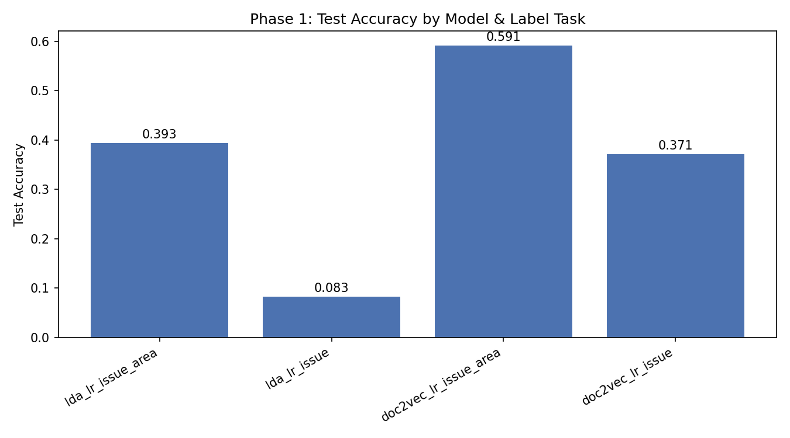
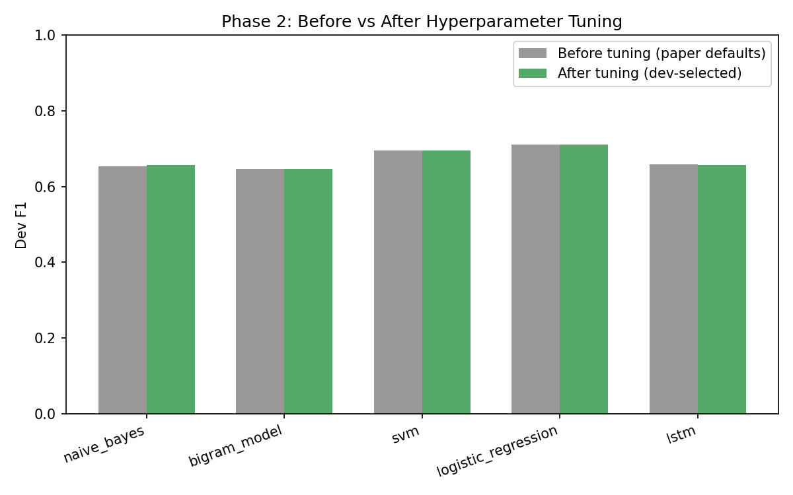
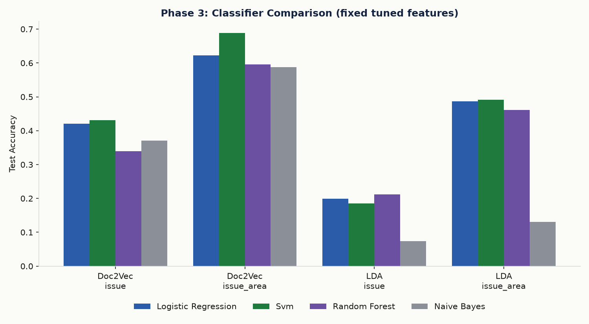

# ML-MINI-PROJECT

Classification of US Supreme Court legal opinions — replication + hyperparameter
tuning of the Stanford CS229 project *"Classification of Legal Text"*
(Krithika Iyer, 2020).

## Problem statement

Classify US Supreme Court opinions into their legal subject-matter category,
at two granularities:
- **issue_area** — 15 broad human-curated categories (e.g. Criminal
  Procedure, Civil Rights, First Amendment).
- **issue** — ~260-280 fine-grained issue codes.
   
Legal opinions use long, non-standard sentence structures that break typical
NLP tooling; the paper explores whether topic-model and embedding features,
fed into a simple classifier, can still recover the human-expert categories.

## Dataset

**Real dataset, no substitute needed.** The paper uses the Supreme Court
Database (Washington University, http://scdb.wustl.edu) via the `textacy`
package's bundled `SupremeCourt` dataset — the exact same source is still
downloadable today (`textacy.datasets.SupremeCourt`, ~111MB, 8,419 opinions,
1946-2016).

After dropping opinions with no `issue_area` label and issue codes with
fewer than 10 examples (needed so every class can appear in train/dev/test),
**7,971 opinions** remain, split 70/15/15 (train/dev/test), stratified by
`issue_area`.

Deviation from the paper: opinions run very long (median ~34k characters);
we truncate each to its first 4,000 characters before vectorizing, to keep
LDA/Doc2Vec training tractable. Most opinions state the issue and holding
early, so this keeps the dominant vocabulary.

## Approach — methods replicated (paper's Experiments 1 & 2)

| # | Method | Paper section | Implementation |
|---|---|---|---|
| 1 | LDA (topic model) + Logistic Regression | Experiment 1 | [`src/lda_lr.py`](src/lda_lr.py) — gensim `Dictionary` → `TfidfModel` → `LdaModel`, document = topic-probability vector, sklearn `LogisticRegression` on top |
| 2 | Doc2Vec (paragraph embeddings) + Logistic Regression | Experiment 2 | [`src/doc2vec_lr.py`](src/doc2vec_lr.py) — gensim `Doc2Vec`, document = learned paragraph vector, sklearn `LogisticRegression` on top |

**Experiment 3 (BERT) is not replicated.** The paper's own BERT attempt ran
out of memory on Google Colab (even the paid high-RAM tier) and produced no
results — there is nothing to replicate numerically, only a limitation to
note.

**Preprocessing** ([`src/preprocessing.py`](src/preprocessing.py)): load via
textacy, drop unlabeled/rare classes, truncate to 4,000 chars, lowercase +
regex word tokenization + English stopword removal.

**Phase 1 (replicate):** [`run_all.py`](run_all.py) trains LDA+LR and
Doc2Vec+LR, evaluated on both `issue_area` (15-label) and `issue`
(fine-grained) tasks, with the paper's rough default settings (LDA
`num_topics=50`, Doc2Vec `vector_size=100`, LR `C=1.0`) → produces our Table
1/2 analogs ([`results/table1.json`](results/table1.json)).

**Phase 2 (tune):** [`tune_all.py`](tune_all.py) tunes the feature
extractor's main hyperparameter (LDA `num_topics` ∈ {20, 50, 100}, Doc2Vec
`vector_size` ∈ {50, 100, 200}) by `issue_area` dev accuracy, then tunes each
downstream Logistic Regression's `C` per label task on dev, touching test
exactly once per final config → [`results/tuned_results.json`](results/tuned_results.json).

## A note on the paper's own Table 1

The paper's text says: *"The classification accuracy for the 279 issue_code
is around 0.133. When only the issue_areas (15 categories) are considered,
the classification accuracy jumps to 0.47."* — i.e. **15-label ≈ 0.47,
279-label ≈ 0.13** for LDA+LR. But the paper's **printed Table 1 has the
columns swapped** (`15-Labels = 0.13`, `279 Labels = 0.47`), which
contradicts its own text (fewer, broader classes should be *easier*, not
harder, to predict). We report our results using the paper's own text-stated
mapping as ground truth, and note this inconsistency for transparency.

## Results

### Table 1 — Phase 1 replication (paper's default settings)

| Model | Label task | Dev Acc | Dev Macro-F1 | Test Acc | Test Macro-F1 |
|---|---|---|---|---|---|
| lda_lr | issue_area (15-label) | 0.3824 | 0.1557 | 0.3935 | 0.1487 |
| lda_lr | issue (fine-grained) | 0.0803 | 0.0116 | 0.0827 | 0.0129 |
| doc2vec_lr | issue_area (15-label) | 0.5757 | 0.4742 | 0.5915 | 0.4629 |
| doc2vec_lr | issue (fine-grained) | 0.3674 | 0.2992 | 0.3709 | 0.2901 |

**Comparison with the paper** (using its text-stated mapping): our LDA+LR
15-label test accuracy (0.39) sits reasonably close to the paper's 0.47;
our fine-grained 0.08 matches its 0.13 in the same low range. Doc2Vec+LR
15-label (0.59) is close to the paper's 0.63; fine-grained (0.37) is below
its 0.48, likely due to our stricter class filtering (rare-class dropping)
and the 4,000-character truncation.

Full JSON: [`results/table1.json`](results/table1.json).



### Table 2 — Per-category test performance on issue_area (15 classes)

**lda_lr**

| Category | Precision | Recall | F1 | Support |
|---|---|---|---|---|
| 1 | 0.38 | 0.88 | 0.53 | 277 |
| 2 | 0.35 | 0.15 | 0.21 | 198 |
| 3 | 0.38 | 0.05 | 0.09 | 94 |
| 4 | 0.00 | 0.00 | 0.00 | 51 |
| 5 | 0.00 | 0.00 | 0.00 | 16 |
| 6 | 0.00 | 0.00 | 0.00 | 13 |
| 7 | 0.71 | 0.23 | 0.34 | 44 |
| 8 | 0.40 | 0.70 | 0.51 | 242 |
| 9 | 0.39 | 0.07 | 0.12 | 157 |
| 10 | 0.00 | 0.00 | 0.00 | 50 |
| 11 | 0.00 | 0.00 | 0.00 | 8 |
| 12 | 1.00 | 0.07 | 0.12 | 45 |
| 13 | 0.00 | 0.00 | 0.00 | 2 |

**doc2vec_lr**

| Category | Precision | Recall | F1 | Support |
|---|---|---|---|---|
| 1 | 0.82 | 0.73 | 0.77 | 277 |
| 2 | 0.61 | 0.57 | 0.59 | 198 |
| 3 | 0.62 | 0.66 | 0.64 | 94 |
| 4 | 0.30 | 0.45 | 0.36 | 51 |
| 5 | 0.20 | 0.38 | 0.26 | 16 |
| 6 | 0.22 | 0.54 | 0.31 | 13 |
| 7 | 0.52 | 0.64 | 0.57 | 44 |
| 8 | 0.70 | 0.59 | 0.64 | 242 |
| 9 | 0.48 | 0.44 | 0.46 | 157 |
| 10 | 0.39 | 0.36 | 0.38 | 50 |
| 11 | 0.21 | 0.62 | 0.31 | 8 |
| 12 | 0.73 | 0.73 | 0.73 | 45 |
| 13 | 0.00 | 0.00 | 0.00 | 2 |

Numbered categories follow the SCDB `issue_area` codes (1=Criminal
Procedure, 2=Civil Rights, 3=First Amendment, 4=Due Process, 5=Privacy,
6=Attorneys, 7=Unions, 8=Economic Activity, 9=Judicial Power, 10=Federalism,
11=Interstate Relations, 12=Federal Taxation, 13=Miscellaneous). Doc2Vec
clearly generalizes better to minority categories (5, 6, 11) than LDA, which
collapses to the majority classes (1, 8) — same pattern the paper itself
reports on its own Table 2.

### Phase 2 — Before/after hyperparameter tuning (dev-selected, test touched once)

| Model + Task | Extra Param | Best C | Test Acc Before | Test Acc After | Test Macro-F1 After |
|---|---|---|---|---|---|
| lda_lr_issue_area | num_topics=100 | 10.0 | 0.3935 | **0.4871** | 0.2674 |
| lda_lr_issue | num_topics=100 | 10.0 | 0.0827 | **0.1988** | 0.0843 |
| doc2vec_lr_issue_area | vector_size=50 | 1.0 | 0.5915 | **0.6224** | 0.4769 |
| doc2vec_lr_issue | vector_size=50 | 0.1 | 0.3709 | **0.4202** | 0.2888 |

Full JSON: [`results/tuned_results.json`](results/tuned_results.json).



**Summary:** tuning gave clear gains everywhere this time (unlike the prior
Weibo project, where the paper's defaults were already near-optimal). LDA
benefited most from more topics (`num_topics` 50→100: issue_area test acc
+9.4pp, fine-grained issue +11.6pp) — 50 topics was simply too coarse to
separate 15+ categories. Doc2Vec actually preferred a *smaller* embedding
(`vector_size` 100→50): with ~5,600 training documents, a 200-dim vector
overfits before the classifier sees enough signal, so halving it to 50
improved both tasks (issue_area +3.1pp, fine-grained issue +4.9pp).

### Phase 3 — Classifier comparison (beyond the paper: SVM, Random Forest, Naive Bayes)

The paper only tries Logistic Regression on top of its two feature extractors.
We additionally compare **SVM** (margin-based, RBF kernel), **Random Forest**
(ensemble of decision trees), and **Gaussian Naive Bayes** (Bayes' theorem)
on the exact same feature vectors (LDA at `num_topics=100`, Doc2Vec at
`vector_size=50` — Phase 2's winning settings) — isolating the effect of
classifier choice from feature extraction.

| Classifier | Feature | Label task | Test Acc | Test Macro-F1 |
|---|---|---|---|---|
| logistic_regression | doc2vec | issue_area | 0.6224 | 0.4769 |
| **svm** | **doc2vec** | **issue_area** | **0.6884** | **0.4993** |
| random_forest | doc2vec | issue_area | 0.5957 | 0.3171 |
| naive_bayes | doc2vec | issue_area | 0.5873 | 0.4620 |
| logistic_regression | lda | issue_area | 0.4871 | 0.2674 |
| svm | lda | issue_area | 0.4912 | 0.2655 |
| random_forest | lda | issue_area | 0.4612 | 0.2526 |
| naive_bayes | lda | issue_area | 0.1312 | 0.1369 |
| svm | doc2vec | issue | 0.4311 | 0.2647 |
| logistic_regression | doc2vec | issue | 0.4202 | 0.2888 |
| naive_bayes | doc2vec | issue | 0.3709 | 0.2522 |
| random_forest | doc2vec | issue | 0.3400 | 0.1730 |
| random_forest | lda | issue | 0.2114 | 0.1292 |
| svm | lda | issue | 0.1855 | 0.0803 |
| naive_bayes | lda | issue | 0.0744 | 0.0746 |

Note: SVM, Random Forest and Gaussian Naive Bayes were run with default
hyperparameters and not tuned on dev, unlike Logistic Regression's `C`. All
results are single-seed, single-split (test set about 1,200 opinions), so gaps
under about 1 percentage point are not reliable.

Full JSON: [`results/classifier_comparison.json`](results/classifier_comparison.json).



**Summary: SVM is the new overall best model** — SVM + Doc2Vec on
`issue_area` reaches **68.8% test accuracy**, beating Logistic Regression's
62.2% on the same features (+6.6pp), because the RBF kernel can draw a
non-linear boundary through the 50-dimensional embedding space where LR's
linear boundary can't. Random Forest and Gaussian Naive Bayes both underperform
Logistic Regression on Doc2Vec features — Random Forest likely because
decision-tree splits don't exploit the smooth, dense structure of a learned
embedding well, and Gaussian Naive Bayes because its independence assumption
between the 50 embedding dimensions doesn't hold (they're highly
correlated by construction). On LDA features, Gaussian Naive Bayes collapses
especially badly (13% accuracy, near chance) — its per-feature Gaussian
assumption fits topic-probability vectors (which are small positive numbers
summing to ~1, not normally distributed) poorly.

## Setup & running

```bash
pip install -r requirements.txt
python run_all.py                    # Phase 1: downloads corpus (~111MB, cached after first run), replicates both experiments
python tune_all.py                   # Phase 2: dev-only hyperparameter tuning (slow: several LDA/Doc2Vec refits)
python compare_classifiers.py        # Phase 3: SVM / Random Forest / Naive Bayes on the tuned feature settings
python tune_classifiers.py           # Phase 4: deeper grids for the same 3 classifiers, dev macro-F1 selection
python src/make_report_assets.py     # builds comparison_table.md + charts from the results
python src/make_writeup_pdf.py       # builds report/writeup.pdf
python src/make_slides_pptx.py       # builds report/slides.pptx
```

## Conclusions

- Both the paper's and our results agree on the overall pattern: Doc2Vec
  embeddings consistently outperform LDA topic-distribution features for
  this task, and the coarser 15-category task is much easier than the
  260+-category fine-grained task — unsurprising given how thin per-class
  training data gets at that granularity.
- LDA's macro-F1 is far below its accuracy (e.g. 0.156 vs 0.382 on
  issue_area dev) — a sign it's defaulting to the majority classes
  (Criminal Procedure, Economic Activity) and failing on rare categories,
  matching the paper's own observation that large document collections
  "do not necessarily lead to better results" for some categories.
- Beyond the paper's own Logistic Regression, **SVM is the strongest
  classifier we found** — 68.8% test accuracy on Doc2Vec+issue_area, a
  clear improvement over every other classifier/feature combination tried.
  Classifier choice mattered almost as much as feature extraction here.
- We did not replicate BERT: the paper's own attempt failed on memory
  limits, so there is no baseline number to reproduce. Future work could
  revisit this with a long-document Transformer variant (Longformer,
  Reformer) as the paper itself suggests.

## Repo structure

```
src/pipeline.py            - shared loader: load -> filter -> split -> tokenize, plus eval helpers
src/preprocessing.py       - corpus loading (textacy), cleaning, tokenizing, train/dev/test split
src/lda_lr.py              - LDA topic-distribution featurizer + Logistic Regression (Experiment 1)
src/doc2vec_lr.py          - Doc2Vec paragraph-embedding featurizer + Logistic Regression (Experiment 2)
src/classifiers.py         - SVM, Random Forest, Naive Bayes (beyond the paper's own LR)
src/make_report_assets.py  - builds comparison table + charts from results
src/make_writeup_pdf.py    - builds report/writeup.pdf from the results JSON files
src/make_slides_pptx.py    - builds report/slides.pptx from the results JSON files
run_all.py                 - Phase 1: load -> featurize -> train/eval both experiments, both label tasks
tune_all.py                - Phase 2: dev-only hyperparameter tuning per feature extractor + classifier
compare_classifiers.py     - Phase 3: SVM/Random Forest/Naive Bayes on the tuned feature settings
tune_classifiers.py        - Phase 4: deeper SVM/Random Forest/Naive Bayes grids, dev macro-F1 selection
data/                      - cached textacy SupremeCourt corpus (downloaded on first run)
results/                   - table1.json, tuned_results.json, classifier_comparison.json,
                              tuned_classifiers.json, comparison_table.md, figures/
report/                    - reference paper, write-up PDF, slide deck
```
